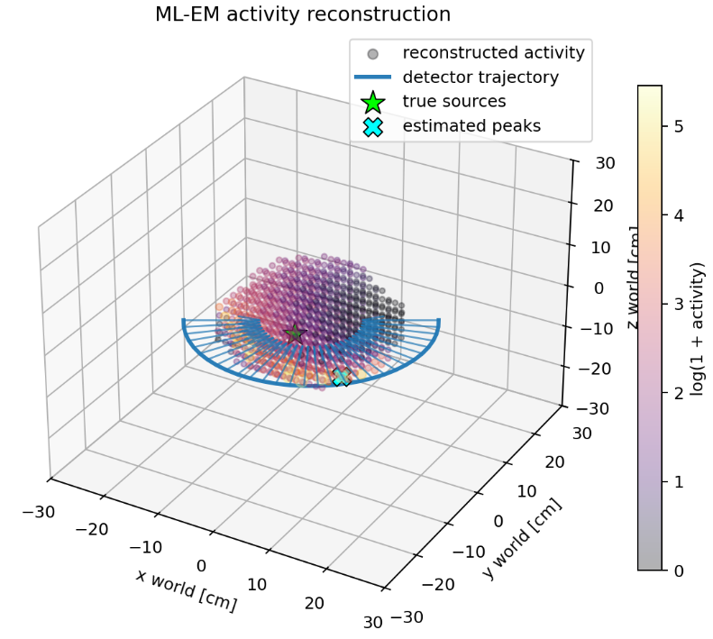
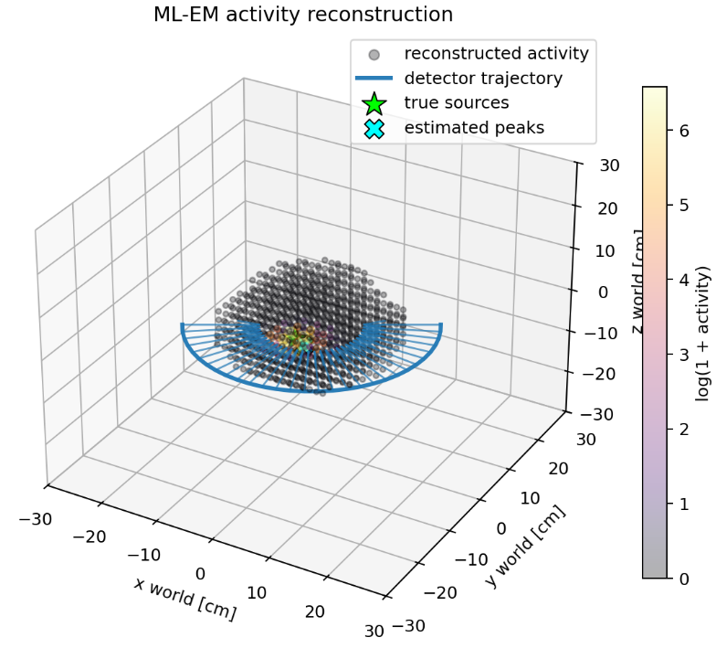
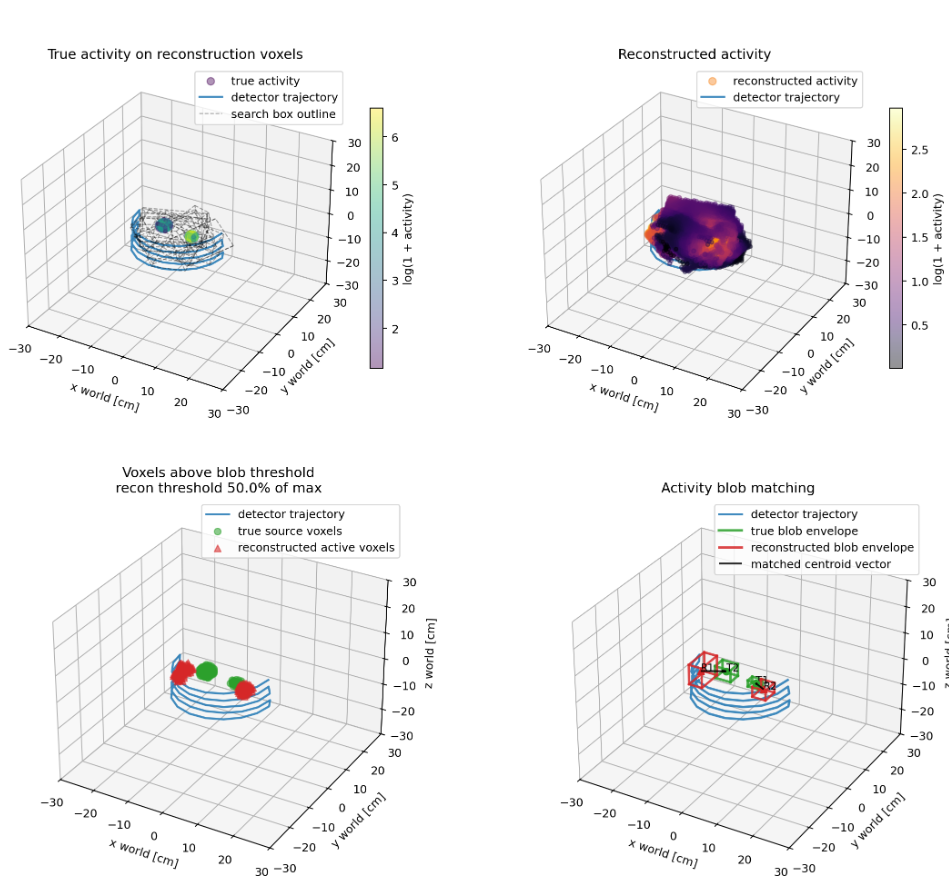

# MultiPoint

1. Adding L1-like penalty improved results HUUUGE, like from 10cm accuracy up to 1-2cm. Before activity map was showing high activity in voxels close to detector, also close to true source, and it was showing activity in many different places
    Also places where activity was, were quite big

Before (without L1-like penalty): \
 \
After (with L1-like penalty): \

    
2. L1-like penalty does not work for multi sources, general idea how to handle more then 1 source: run ml-em to find first source, then subtract it from measurements and run ml-em again to find second source, repeat until no more sources are found. THIS IS GENERAL IDEA, NOT HOW EXACTLY SHOULD WORK.

3. Idea no. 2 is terrible, because while reconstructing first source, we have counts for every, and for rest the same. Moreover, error can rise while deleting from counts estimated constibution of single sources, becuase estimation itself is not perfect.

4. Conception was changed, we are not searching for points, but for area radiations

5. Collimator improved results significantly, without it algorithm is not able to predict anything, it is only showing activity close to detector. With collimator in some scenarios, it can predict radiation ares at least close to real ones.

6. Now algotihm needs improvement to predict sources not close to detector, but close to real source positions, when it will be close enough, we can then work on predicted radiation areas sizes.

7. Instead of physics formula for expected counts for specific detector position, make measurements for different positions relative to source, and then take expected counts from this interpolated matrix. [Detection models for freehand SPECT
reconstruction]. But then we still to simulate attenuation provided by skin/organ

8. Do more reseatch on reconstruction algorithms

9. Maybe ML model? :)